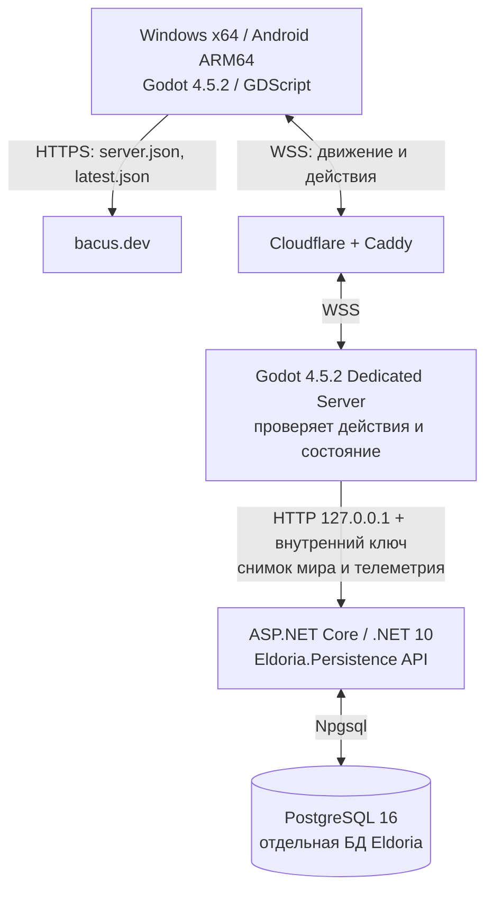

# Eldoria — актуальное состояние проекта

**Дата сверки:** 2 ноября 2026. **Источник:** код Godot/.NET, история TASK-001…019, локальный запуск теста TASK-020 и проверка работающих production-сервисов. Это документ **текущей реализации**; проектная концепция — отдельно в [ELDORIA_DESIGN_AND_ARCHITECTURE_v0.1.md](ELDORIA_DESIGN_AND_ARCHITECTURE_v0.1.md).

> **Опубликовано: v0.5.2. Разрабатывается: TASK-020 (крафт каменного топора), не выпущено.**
> Не путать документацию/ассеты/автотесты с тестом FPS на реальном Android или готовой MMO.

## 1. Кратко: что сделано

| Область | Работает в v0.5.2 | Что осталось |
| --- | --- | --- |
| Клиенты | Windows x64 (ZIP), Android ARM64 (подписанный debug APK), автообновление/уведомление | Реальные замеры FPS, отладка мобильной эргономики, iOS |
| Мультиплеер | Один публичный мир, Cloudflare WSS, отдельный Godot dedicated server, два независимых клиента, реконнект | Нагрузочные испытания, большой онлайн, зоны |
| Мир и графика | Стилизованный процедурный рельеф, 3D-лес Quaternius CC0, камни, трава, MultiMesh, High/Low | Биомы, пещеры, воксели, полный разрушаемый грунт |
| Персонаж | KayKit CC0 Knight / Rogue / Mage, idle/walk/run/jump, эмоция Wave, сбор/рубка, камера, следование рельефу | Бой, инвентарь экипировки, здоровье, голод/холод |
| Управление | Windows WASD/Shift/Space/F/B/V; Android аналоговый джойстик и touch-кнопки | Полировка UI, аппаратные тесты на разных телефонах |
| Ресурсы | Дерево/камень/растения, проверка дистанции/задержки на сервере, частный инвентарь | Возобновление ресурсов, разные инструменты/качество |
| Изменение леса | После полного сбора дерево/трава исчезают, коллизия дерева снимается, сохраняется; падение и звук, 1–3 визуальных следа рубки | Плавное дерево с физикой, регенерация, глубокое разрушение грунта |
| Строительство | Костёр и палатка; серверные стоимость, рельеф, коллизии, расстояние; 3D-превью, сообщения об ошибках | Взаимодействие с сооружениями, улучшения, права владения |
| Сохранение | PostgreSQL 16 через закрытый .NET 10 API, анонимный профиль, инвентарь, ресурсные дельты и постройки | Точечные транзакции вместо полного снимка, восстановление токена |
| Телеметрия | FPS/просадки/p95 кадра/память/RTT/Low-High/версия/платформа, приватная сводка, opt-out | Сбор реальных чисел, сравнение телефонов, профилирование |
| Крафт | **Только TASK-020 в рабочем дереве**: рецепт каменного топора у костра и ускоренная добыча | Завершить PostgreSQL E2E, PR, отдельное разрешение на релиз |

## 2. Версии и история

| Версия | Главное | Состояние |
| --- | --- | --- |
| v0.3.0–v0.3.1 | Реальные Quaternius-модели леса, коллизии, MultiMesh, High/Low, FPS HUD | История релизов |
| v0.4.0–v0.4.1 | Три анимированных KayKit-героя, исправлено направление движения | История релизов |
| v0.5.0 | Android-джойстик, прыжки, сбор ресурсов, PostgreSQL-профили, костёр и палатка | История релизов |
| v0.5.1 | Исчезновение ресурсов, падение деревьев, следы рубки, звуки, 3D-превью, мобильный Build mode | История релизов |
| **v0.5.2** | **Серверная диагностика производительности (TASK-018/019)** | **Действующий production** |
| TASK-020 | Каменный топор и крафт у костра | **Только разработка, не релиз** |

Сайт и загрузки: https://bacus.dev/projects/eldoria/ (Windows и Android). Серверная конфигурация: https://bacus.dev/projects/eldoria/server.json, манифест: https://bacus.dev/projects/eldoria/latest.json. Клиент и сервер должны иметь согласованную версию. Исходники: https://github.com/niko009/eldoria-game; сайт: https://github.com/niko009/bacus.dev.

**Проверка production на дату документа:** публичный манифест и протокол указывают **0.5.2**; Godot WSS и внутренний .NET API активны; PostgreSQL отвечает. Зафиксированный срез данных при проверке: 3 профиля, 4 постройки, 19 изменённых ресурсов, 1 тестовая запись телеметрии. Это *моментальный срез*, а не статистика пользователей и не обещание неизменности количеств.

## 3. Фактическая архитектура

**Текущий authoritative игровой сервер — Godot**, а не ASP.NET Core. **.NET API обслуживает хранение и аналитику**, не моделирует движение/NPC. ENet/UDP поддерживается для локальных тестов; production-клиенты используют WSS. Клиент не имеет доступа к SQL, ключам API или файловым резервным копиям.

Используемые модули:
- `client/main.gd` — протокол/серверные проверки, UI, сбор, строительство, анонимная сессия, телеметрия.
- `client/forest_world.gd` — процедурный лес, MultiMesh, высота ландшафта, коллизии, ресурсы, повреждения деревьев.
- `client/animated_actor.gd`, `client/platform_input.gd` — анимация и управление.
- `client/building_object.gd`, `client/harvest_vfx.gd`, `client/tree_damage.gd` — строения и эффекты.
- `client/postgres_world_store.gd` и `client/world_save.gd` — PostgreSQL через локальный API и тестовый/legacy JSON.
- `client/performance_telemetry.gd`, `client/telemetry_sink.gd` — агрегирование и неблокирующая отправка показателей.
- `server/Eldoria.Persistence/Program.cs` — приватный API хранения, транзакции снимка и телеметрия.
- `server/Eldoria.Persistence/sql/001_init.sql`, `002_telemetry.sql` — база мира и диагностика; **`003_stone_axe.sql` — пока только в разработке**.

### Сохранение и безопасность

Анонимная идентификация без логинов/паролей: клиент создаёт случайный секрет и хранит локально; в PostgreSQL сохраняется только SHA-256. Удаление данных приложения может лишить игрока доступа к прежнему профилю. Логин другого устройства с этим секретом эквивалентен доступу к профилю — полноценного восстановления и защиты от всех атак нет.

Текущие таблицы production: `eldoria_worlds`, `eldoria_players`, `eldoria_resources`, `eldoria_buildings`, `eldoria_telemetry`. Профиль содержит аватар и wood/stone/herb; постройки и остатки ресурсов сохраняются после рестарта Godot. Обновление снимка использует транзакцию PostgreSQL и оптимистическую проверку ревизии, но **синхронно перезаписывает состояние мира целиком**: это ограничение масштабирования.

Внутренний API и PostgreSQL привязаны к loopback сервера, защищены серверным ключом; секреты находятся в закрытых файлах **вне Git**. Игровой клиент общается только с публичным WSS и HTTPS-конфигурацией. Production включает резервные копии. **Не откатывать дамп БД поверх новых данных без анализа потерь.**

### Техническая телеметрия (v0.5.2)

Примерно раз в 60 секунд при включённом параметре `Performance data: ON` клиент формирует агрегат: `fps_avg`, `fps_low_5`, `frame_p95_ms`, `memory_mb`, `rtt_ms`, версия, платформа (`android/windows/test`), пресет (`low/high`), число кадров. Нет отправки токена устройства, IP, имени, переписки или свободного текстового лога. На сервере действуют ограничения частоты; очередь HTTP ограничена; неудача отправки не должна останавливать игру. Хранение — 14 дней, затем удаление.

Закрытый путь сводки: `GET /v1/telemetry/summary` (только приватный API с ключом). Полная production-цепочка «публичный клиент → WSS → Godot → .NET → PostgreSQL → summary» проверена. **Верифицированный образец был синтетическим, platform=test**, а не реальным измерением FPS на телефоне. Устойчивые выводы об оптимизации возможны после фактической эксплуатации v0.5.2.

## 4. Как играть в опубликованной v0.5.2

**Windows:** WASD — движение; Shift — бег; Space — прыжок; F — собрать; B — строить; V — 3D-предпросмотр; мышь — управление камерой; E — Wave. В игре выбор Knight/Rogue/Mage, Sound ON/OFF, Performance data ON/OFF.

**Android:** левый аналоговый джойстик; Sprint / Jump / Gather, **Build mode** → Campfire/Tent → зелёная/красная модель → PLACE или CANCEL. Успешный сбор и строительство подтверждаются сервером.

Костёр стоит **3 дерева + 2 камня**, палатка — **5 дерева + 2 растения**. Ресурсы расходуются только при подтверждённой операции и успешной записи. Полностью срубленное дерево исчезает и больше не мешает проходу; собранная трава исчезает. Сохраняются профиль, инвентарь и изменения общего мира.

**Известное аппаратное ограничение:** пользователь проверял предыдущие релизы и сообщал, что базовые механики работают. Для v0.5.2 реальные показатели FPS/памяти на конкретных Android/Windows устройствах пока не собраны и не проанализированы в этом документе; автотесты на Linux не являются измерением мобильной производительности.

## 5. Текущая разработка — TASK-020, не выпускать

Рабочая ветка: `feature/TASK-020-stone-axe-crafting`. По состоянию на проверку изменения **незакоммичены/не опубликованы**. В ней установлен `DEVELOPMENT_BUILD=true`, поэтому обычное автоподключение к production отключено.

В коде добавлены: изготовление каменного топора за **2 дерева + 2 камня**, только в радиусе 4 м от костра; проверка сервером, запрет повторного топора, откат при ошибке сохранения; топор в инвентаре (`axe: 0|1`), ускоренная добыча — до **2 wood за рубящий удар**; UI для Windows (**C**, Craft button) и Android (**CRAFT AXE** в Build mode). Подготовлена отдельная SQL-миграция `003_stone_axe.sql`, которая добавляет столбец `axe` в `eldoria_players` с DEFAULT 0.

**Проверено непосредственно при обновлении документации:** Godot headless import PASS; `client/tests/craft_axe_e2e.gd` в двух отдельных запусках с общим тестовым JSON — **PASS** (дистанция, цена, запрет дублирования, две древесины за удар, сохранение топора после рестарта). **Не утверждать**, что новая механика уже проверена на устройствах, опубликована или что применена PostgreSQL-миграция в production. Тестовый PostgreSQL E2E и полная регрессия TASK-020 требуют отдельного подтверждённого PASS.

## 6. Автоматические проверки и релизная дисциплина

- `bash tests/run_dev_gameplay_e2e.sh`: ENet, Godot dedicated, WebSocket, персонажи/камера/прыжки/джойстик/ресурсы/строительство, имитация восстановления мира; часть реальных графических тестов запускается через Mesa/Xvfb.
- `bash tests/run_telemetry_e2e.sh`: Godot-клиент → dedicated server → приватный тестовый HTTP; дубликаты и некорректные отчёты отклоняются.
- `bash tests/run_postgres_e2e.sh`: **только выделенная тестовая PostgreSQL**, .NET/Npgsql, анонимные профили, постройки, восстановление, телеметрия; в ветке TASK-020 добавлена проверка крафта, её успех нужно проверить перед следующей сборкой.
- `bash tests/build_windows.sh`, `bash tests/build_android_debug.sh` и `node tools/generate_manifest.js <version> ...`: экспорт и подписанные артефакты/хеши.
- Релиз требует сохранения БД и прежнего сервера, согласованной версии клиент/сервер, проверки WSS/SQL, APK подписи/версии, публичных ZIP/APK по SHA-256 и сохранения исходников в GitHub.

Последний завершённый релиз: [TASK-019](TASK-019_TELEMETRY_RELEASE.md). Для истории реализации: [TASK-001…019](../README.md). Исторические TASK-файлы сохраняют **статус на момент выполнения**, даже если пишут «не опубликовано»; текущую истину брать из **этого документа**, а не из старых протоколов.

## 7. Что ещё НЕ сделано

Нет полноценных NPC/королевств/граждан/профессий; нет PvE/PvP, рейдов, экономики и дипломатии. Нет hunger/cold survival, торговли, больших биомов, подземных городов, воксельной разрушаемости/пещер/подкопов, реалистичной физики разрушений и проверенных 10 одновременных игроков. Нет логина/восстановления анонимного профиля, надёжной системы борьбы с читами на уровне production MMO, детального профилирования Android. Текущая серверная запись полного снимка и ограниченная зона мира предназначены для прототипа, не для масштабируемой MMO.

## 8. Ближайшая очередь

1. **Собрать реальные данные v0.5.2** по Android и Windows: по платформе, графическому пресету, p95 кадра, FPS и RTT; не оптимизировать на основе одной тестовой записи.
2. **Довести TASK-020:** изолированная PostgreSQL `003_stone_axe.sql`, E2E двух клиентов и рестарта, проверка расхода и отката, тест Android UI; затем отдельный запрос разрешения на релиз.
3. **Оптимизация и игровой цикл:** выбрать реальные узкие места по телеметрии; развить взаимодействия с костром/палаткой, крафт, затем минимальных NPC. Масштабируемость хранения и разграничение прав потребуется до полноценной экономики.

См. [HANDOFF_NEXT_CHAT.md](HANDOFF_NEXT_CHAT.md) для практического продолжения разработки, [концепцию](ELDORIA_DESIGN_AND_ARCHITECTURE_v0.1.md) для будущего дизайна и [TASK-019](TASK-019_TELEMETRY_RELEASE.md) для последней подтверждённой публикации.
